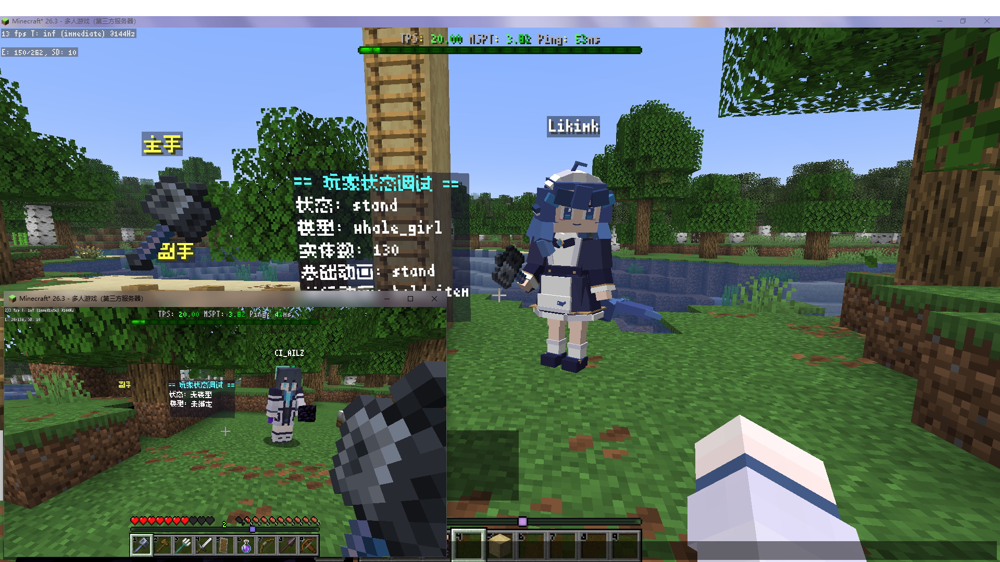

# 自定义展示实体 · Display Custom

在插件服务器上使用方块、物品和文字展示实体拼装成的自定义模型，支持动画、玩家绑定和持久化。
（Blockbench 扩展编辑）

> [!IMPORTANT]
> 使用本插件时请勿滥用功能，您也必须要注意此插件容易意遇到版权问题。
>
> 您应该清楚在不合时宜的场景给别人观看不雅/不当内容的模型是不正确的行为，且是对你有风险的（甚至是法律风险）。  
> 
> 如果在搭载本插件的服务器游玩，除非服务器管理员严格把控模型，您应当知道可能会看到会让你感到反感合适，且无法在公众展示的糟糕内容。
> 
> 如果您看到了不喜欢的模型找我诉说的话，对不起我帮不到你，我很难去管理他们。


> [!CAUTION]
> 如果您因为使用本插件传播不当内容而出事情的话，概不负责  

> [!WARNING]
> 原版生存服务器能够承载的实体数量为25000~30000，超出的话可能会导致掉刻！

## 支持的服务端

**Paper** https://papermc.io/  
**Purpur** https://purpurmc.org/  
  
*（其他服务端未测试）*

## 效果展示
  

## 自动构建

[GitHub Actions](https://github.com/theLIKImk/displaycustom/actions/workflows/build.yml) 会在推送到 `main` 或向 `main` 提交拉取请求时运行，也可通过 **Run workflow** 手动执行。构建成功后，在当次运行页面的 **Artifacts** 下载 `paper-plugin` 或 `blockbench-plugin`。

## 从源码构建

使用 JDK 25、Maven 3.9+ 和 Node.js 22+，在仓库根目录运行：

```sh
npm ci --prefix editor
node scripts/build-resource-pack.mjs
mvn -B -ntp clean package
node scripts/test-blockbench-bridge.mjs
node scripts/build-blockbench-plugin.mjs
```

- 服务端插件生成在 `target/display-custom-0.0.1.jar`。需要本地 Maven 依赖时，将 `package` 换成 `install`。
- Blockbench 扩展生成在 `release/display_custom_bridge.js`，可在 Blockbench 的插件管理界面从文件加载。
- `editor/src/` 提供两个插件构建与测试所用的共享模型协议和资源包代码。

## 安装

把 JAR 放入 Paper 的 `plugins/` 后启动。

- [Paper 插件 API](docs/PLUGIN_API.md)
- [Blockbench 使用说明](docs/blockbench-bridge.md)
