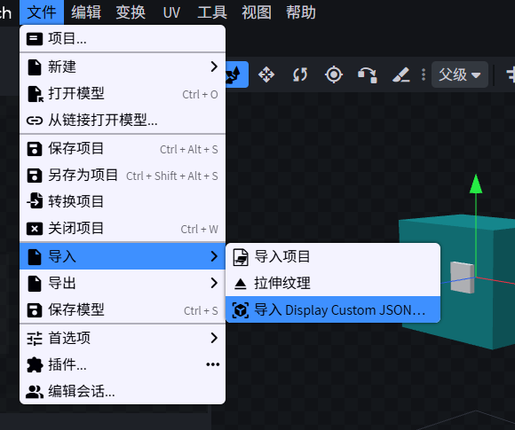
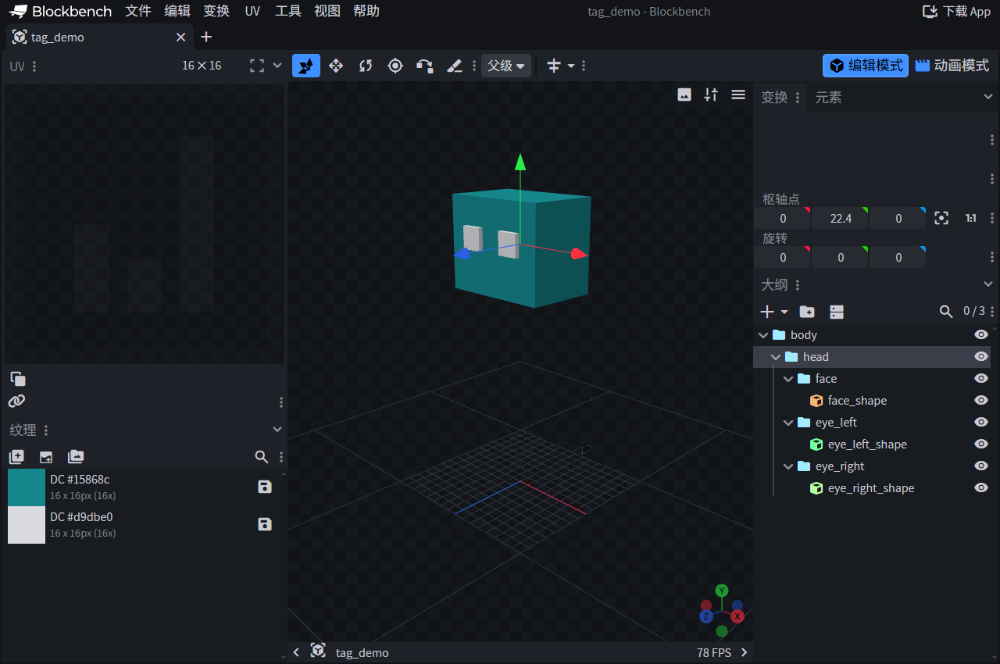
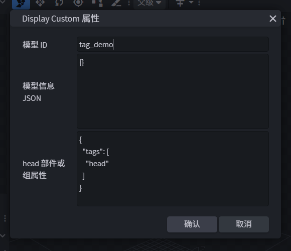
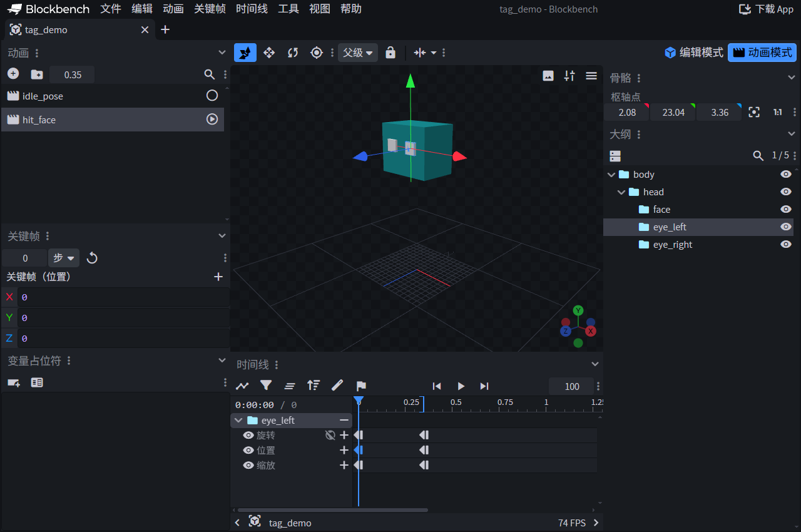
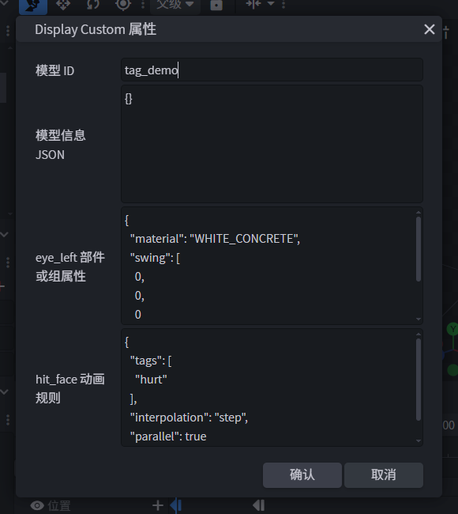
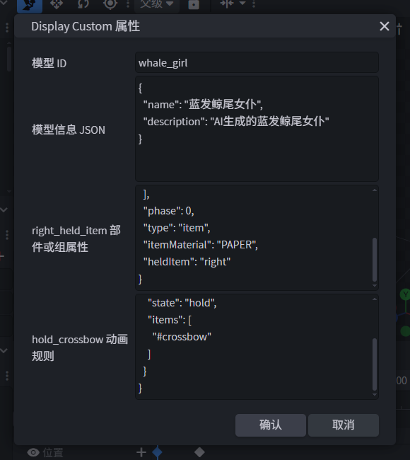
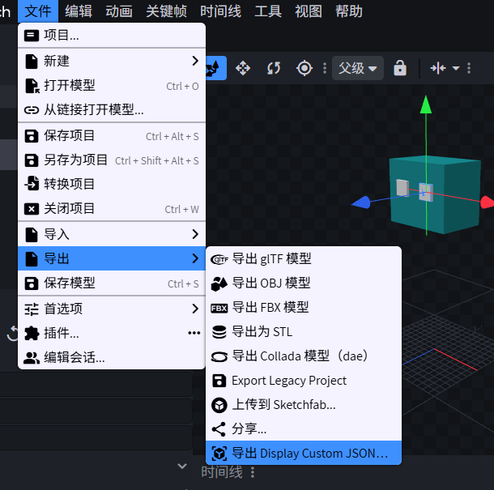

# Blockbench 建模标签基准

适用于 **Blockbench 5.x**、**Display Custom Bridge 0.1.0** 和服务端 **自定义展示实体 0.0.1**。用 Blockbench 调整方盒、骨骼和动作，再在 **编辑 → Display Custom 属性…** 填写服务端识别的标签。桥接会根据使用的字段导出对应的 JSON 版本。

下文截图来自 Blockbench 网页版 5.2.2 的简体中文界面。大纲、时间线和属性框可与范例工程对照。

## 1. 安装和打开工程

1. 从发布页下载 `display_custom_bridge.js`，在 Blockbench 的 **文件 → 插件 → 从文件加载** 选择该 JS。[v0.0.1 安装文件](https://github.com/theLIKImk/displaycustom/releases/tag/v0.0.1)
2. 要跟着范例操作，下载 `tag_demo.json`，通过 **文件 → 导入 → 导入 Display Custom JSON…** 打开。范例有一个头部骨骼、一个站立动作和一个受伤动作。[下载 tag_demo.json](https://raw.githubusercontent.com/theLIKImk/displaycustom/main/docs/examples/tag_demo.json)
3. 做新模型时，在新建页面选择 **Display Custom**。在编辑模式添加至少一个方盒，再打开 **编辑 → Display Custom 属性…**，设置 **模型 ID**，如 `my_model`。允许 1–48 个小写字母、数字、下划线或短横线。



## 2. 在编辑模式布置方盒和骨骼

- **比例与朝向**。每 16 个 Blockbench 单位对应 Minecraft 一格，脚底通常放在 Y = 0。角色以 +Y 向上，+Z 向前。以坐标轴为准检查正面。
- **层级与支点**。在右侧大纲（Outliner）添加组作为骨骼，拖拽部件到对应组下。头部支点放在颈部，手臂支点放在肩或肘，腿部支点放在髋或膝。先在编辑模式确定默认姿态，再到动画模式做动作。
- **命名**。组与方盒的名称在整个工程内唯一。成对骨骼和可动部件用 `left_`、`right_` 前缀，例如 `left_forearm`、`right_forearm`，方便左手使用物品时镜像轨道。左右以角色自身为准。
- **导入模型的部件组**。导入后，每个部件有一个专用组，内含一个预览方盒。移动或旋转该组。要改方盒尺寸，从两侧对称调整，使中心与组原点重合。新增子骨骼时，把它挂到普通骨骼组。

### 标记跟随头部视角的节点

在大纲选中颈部上的 `head` 文件夹。如果其子方盒也被选中，再单击一次同一行，只保留文件夹选中。打开 **编辑 → Display Custom 属性…**，确认文本框左侧显示 **head 部件或组属性**，然后填写下面的标签。





```json
{ "tags": ["head"] }
```

若属性框已有内容，只加入或修改 `tags` 字段，保留该对象的其他字段。然后把脸、眼睛、嘴、头发和头饰挂在头部组下。游戏中最外层的 `head` 节点会叠加玩家的视角，子节点继承旋转。每个节点可填一个部位标签。

| 标签 | 在大纲中标记 |
| --- | --- |
| `body` | 身体或模型根 |
| `head` | 头部骨骼，随玩家视角转动 |
| `arm` | 手臂或前臂 |
| `leg` | 腿部 |
| `foot` | 脚部 |

### 设置方块、颜色或文字

选中方盒，在同一个属性框设置部件类型。例如用青色混凝土时填 `{"type":"block","material":"CYAN_CONCRETE"}`。使用公共颜色立方体时填 `{"type":"item","itemMaterial":"PAPER","itemModel":"display_custom:colors/ff0000"}`。文字部件可填 `{"type":"text","text":"你好"}`。

Blockbench 里的方盒用于定位和预览。游戏内材质由 Minecraft 资源包决定。导出 JSON 时会保留 `itemModel` 资源键，Blockbench 工程里的任意贴图需要另外做成 Minecraft 资源包。

## 3. 在动画模式设置玩家动作

1. 切换到 **动画（Animate）**，在动画列表新增动作，例如 `walk_cycle`。在动画设置中填写时长。站立、行走等持续动作可设为循环。时间轴用秒，Minecraft 的 1 tick 对应 0.05 秒。
2. 选中大纲里的**骨骼组**，把播放头移到目标时间，给位置、旋转或缩放通道加关键帧。导出支持局部数值轨道与 **线性（Linear）**、**定格（Step）** 插值。要单独动画化一个新建方盒，先给它建一个骨骼组，再对该组打关键帧。
3. 在动画列表选中刚做好的片段。打开 **编辑 → Display Custom 属性…**，在 **动画规则** 文本框填入 `{"tags":["walk"]}`。时长与循环方式在 Blockbench 动画设置里改。每个状态标签在整份模型中只分配一次。



| 在动画规则填写的标签 | 游戏状态 |
| --- | --- |
| `stand` / `walk` / `run` | 站立 / 行走 / 疾跑 |
| `sneak` / `sneak_walk` | 潜行静止 / 潜行移动 |
| `sit` / `climb` | 乘坐 / 攀爬 |
| `jump` / `fall` | 离地上升 / 离地下落 |
| `swim` / `fly` / `sleep` | 游泳 / 飞行或鞘翅滑翔 / 睡觉 |

插件按睡眠、乘坐、飞行、游泳、攀爬、离地、潜行、地面移动、站立的顺序判断。先查标签，再查同名动画。`run` 可回退到 `walk`，`sneak_walk` 可回退到 `sneak` 或 `walk`，`fall` 可回退到 `jump`，最后回退到站立或基础姿态。死亡动作将动画命名为 **`death`**，设置为单次播放。

## 4. 制作受伤表情

1. 给眼睛和嘴分别安排骨骼组，挂到头部组下。在动画列表新增 `hit_face`，时长例如 0.35 秒，设置为单次播放。
2. 选中该动作，在 **动画规则** 输入 `{"tags":["hurt"],"parallel":true}`。这段动画只填 `hurt` 一个标签。

   

3. 只给眼睛和嘴的组打关键帧。例如旋转两段线条做出 `>` 和 `<`，再用两段交叉的线条做嘴部 `x`。用定格插值可让表情瞬间切换。实际受伤时，服务端只覆盖这些轨道，行走和武器动画继续播放。
4. 范例还演示了五官显隐。当前桥接会随 `.bbmodel` 保留从 JSON 导入的显隐及文字关键帧。要新增这类关键帧，可导出 JSON 后在 Display Studio 里编辑，再导回 Blockbench。

## 5. 安装握点和绑定物品动作

先在右手或前臂组里添加一个小方盒作为握点，例如 `right_held_item`。选中它，在 **部件或组属性** 输入 `{"type":"item","heldItem":"right"}`。左手同理，用 `"heldItem":"left"`。每侧最多一个握点，留空静态 `itemModel`。握点的局部位置、旋转和尺寸决定游戏里原版物品的持握方式，需进服分别检查两只手。

下图用 `whale_girl` 示范同一个窗口的两个输入框。上方是右手握点，下方是握持弩时触发的 `hold_crossbow` 动画规则。



在动画模式制作动作，只给需要的手臂和握点所在骨骼打关键帧。如果握点要独立于前臂转动，先给它单独建组。选中这段动画，在 **动画规则** 填写下列设置即可把挥击绑定到剑类和资源包里的佩剑。

```json
{
  "parallel": true,
  "itemUse": {
    "state": "use",
    "items": ["#sword", "my_pack:steel_sabre"]
  }
}
```

| 物品规则 | 在动画规则里填写 |
| --- | --- |
| 握着弩瞄准 | `"state": "hold", "items": ["#crossbow"]` |
| 弓或盾牌正在使用 | `"state": "charge", "items": ["#bow"]` 或 `["#shield"]` |
| 挥剑、射箭等使用事件 | `"state": "use"`，再填对应的物品选择器 |
| 长矛三阶段蓄力 | `"state": "charge", "items": ["#spear"], "timing": "kinetic"`。这段动作设为单次播放 |

`items` 可以填写资源包物品模型键、原版物品 ID、类别或 `*`。匹配优先级依次降低，例如 `my_pack:steel_sabre`、`minecraft:diamond_sword`、`#sword`、`*`。同一个 `state` 与选择器组合只绑定一段动画。

允许的类别为 `#sword`、`#spear`、`#axe`、`#trident`、`#mace`、`#shield`、`#pickaxe`、`#fishing_rod`、`#bow`、`#elytra`、`#crossbow`、`#other`。

物品动画默认并行。用 `"parallel":true` 做边走边攻击时，只记录需要移动的手臂等轨道。若设成 `false`，该动作会独占模型，未打关键帧的部件采用默认姿态。

## 6. 保存、导出和进服验证

1. 用 **文件 → 保存项目** 保留可继续编辑的 `.bbmodel`。再用 **文件 → 导出 → 导出 Display Custom JSON…** 生成服务器文件，例如模型 ID `my_model` 对应 `my_model.json`。

   

2. 将 JSON 放进 `plugins/DisplayCustom/models/`，执行 `/dc reload`。使用自定义材质时，在 Minecraft 客户端启用对应资源包。
3. 执行 `/dc modelinfo my_model` 核对头部标签、状态映射、物品规则和握点。执行 `/dc use my_model` 绑定，再检查转头、走跑、握持武器和受伤表情。需要看自己的模型时使用 `/dc showmemodel`。
4. 单独测试动作时，用 `/dc spawn my_model` 获取实例 ID，再用 `/dc play <实例ID> <动画名> 1` 播放。
